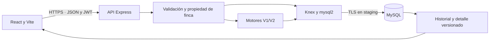
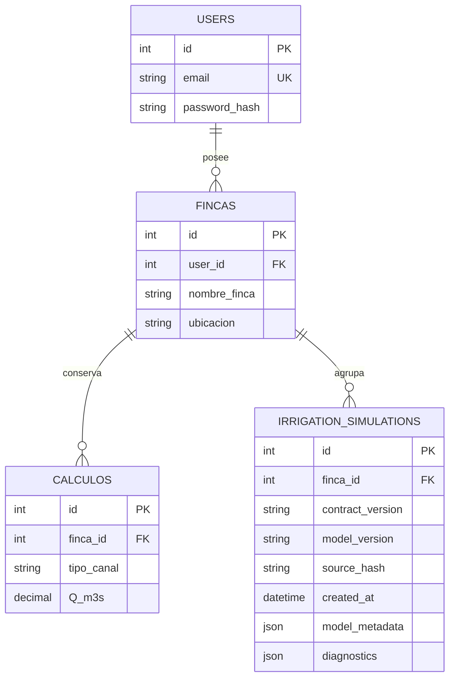

# RiegAR · Guía académica

## Objetivo y alcance

El riego por surcos distribuye agua a lo largo de canales en el suelo. El productor o estudiante necesita relacionar la demanda del cultivo, la reserva de agua, la geometría y los tiempos de aplicación. RiegAR permite organizar escenarios por finca, estimar magnitudes con un modelo derivado de una planilla y conservar resultados versionados para su consulta.

La aplicación incluye registro, sesión, alta y edición de fincas, historial por finca y lectores V1 y V2. El asistente V2 y su recorrido completo pueden demostrarse con la API simulada de desarrollo. Manning conserva su cálculo hidráulico, exportación CSV y guardado histórico asociado a finca cuando hay API.

## Arquitectura y datos



- **Frontend.** React 18, Vite, React Router y SCSS Modules. Gestiona navegación, captura de entradas, validación de interfaz, sesión, consultas y presentación de resultados. El cliente HTTP es compartido.
- **Backend.** Node.js, Express, bcrypt, JWT, Knex y mysql2. Valida el payload y la sesión, verifica propiedad de la finca, selecciona el descriptor activo para altas y el contrato persistido para lecturas.
- **Persistencia.** MySQL almacena `users`, `fincas`, `calculos` (Manning), `irrigation_simulations` y las dos tablas de seguimiento de Knex. Un usuario posee fincas. Cada finca agrupa cálculos Manning y simulaciones. El snapshot contiene entradas, resultados, fecha, versión, hash de procedencia, metadata y diagnósticos. El índice de historial ordena por finca, fecha e ID. La FK de simulaciones restringe el borrado de la finca y la API devuelve 409 si conserva simulaciones.
- **Sesión y seguridad.** El backend compara hashes bcrypt y valida el JWT de cada acceso protegido. El frontend conserva el token en `localStorage`, comprueba vencimiento para la navegación y sincroniza el cierre de sesión. La autorización por finca se aplica en el servidor. CORS utiliza orígenes definidos y el despliegue requiere HTTPS, secretos fuera del repositorio y una cuenta MySQL de privilegios limitados. El almacenamiento del token hace importante controlar la inyección de scripts.



El diagrama muestra las entidades de negocio y campos representativos. Knex conserva por separado su registro de migrations y el lock.

## Modelo de riego por surcos

El servidor valida y normaliza los datos de cultivo, suelo, surcos y riego. La demanda acumulada simplificada se obtiene de ETo × Kc × días. La reserva útil se estima con la diferencia de humedad entre capacidad de campo y punto de marchitez, densidad y profundidad radicular. El área de referencia de cada surco combina espaciamiento y longitud. El volumen aplicado por surco resulta de caudal × duración en segundos. La infiltración en tres puntos se estima mediante el coeficiente del modelo y la raíz del tiempo de oportunidad. V2 multiplica el volumen por la cantidad de surcos para obtener el total del escenario. Los diagnósticos P01–P05 son comparaciones del modelo y tienen alcance estimativo.

| Modelo | Alcance |
|---|---|
| V1 | Ancho de surco y 14 magnitudes. El descriptor de escritura original es V1. |
| V2 | Espaciamiento, cantidad de surcos, consumo diario, plazos teóricos y totales del escenario. El lector interpreta 19 magnitudes. |
| Manning | Área y perímetro mojado, radio hidráulico y caudal en canales según geometría, rugosidad y pendiente. Se almacena en `calculos` y conserva sus rutas históricas. |

### Las 19 magnitudes V2

| Magnitud | Unidad | Interpretación |
|---|---|---|
| Lámina objetivo | mm | Demanda acumulada simplificada. |
| Consumo diario del cultivo | mm/día | ETo × Kc. |
| Agua útil disponible | mm | Reserva teórica entre capacidad de campo y punto de marchitez. |
| Capacidad disponible por surco | L | Agua útil expresada como volumen sobre el área de referencia. |
| Lámina máxima según umbral | mm | Fracción de la reserva útil según el umbral ingresado. |
| Volumen máximo según umbral por surco | L | Lámina del umbral aplicada al área de referencia. |
| Duración teórica de la reserva útil | días | Reserva útil dividida por consumo diario, desde capacidad de campo. |
| Plazo teórico hasta el umbral | días | Lámina del umbral dividida por consumo diario, desde capacidad de campo. |
| Volumen aplicado por surco | L | Caudal multiplicado por el tiempo de riego. |
| Infiltración estimada al inicio | mm | Lámina al inicio con el tiempo de oportunidad del modelo. |
| Infiltración estimada en la mitad | mm | Lámina en el punto medio. |
| Infiltración estimada al final | mm | Lámina al final, descontando el tiempo de avance. |
| Volumen útil estimado por surco | L | Estimación a partir de la infiltración en el punto medio. |
| Pérdidas estimadas por surco | L | Diferencia entre el volumen aplicado y el volumen útil estimado. |
| Volumen total aplicado | L | Volumen por surco multiplicado por cantidad de surcos. |
| Volumen total aplicado | m³ | Conversión del total de litros a metros cúbicos. |
| Eficiencia estimada de aplicación | % | Proporción del volumen aplicado que el modelo estima útil. |
| Relación de avance | % | Tiempo de avance respecto de la duración del riego. |
| Caudal máximo no erosivo estimado | L/s | Umbral calculado con la pendiente y los parámetros de la planilla. |

Con consumo diario cero, los dos plazos son `null`. La cifra de pérdidas representa un residuo del modelo. La interfaz puede abreviar valores con indicación de aproximación y consultar la precisión del snapshot. El modelo requiere contrastación de campo para usos agronómicos fuera del alcance académico.

## Instalación y uso

1. Instalá Node.js y npm. Esta fase se verificó con la versión consignada en el checkpoint. Para un recorrido con API, usá una instancia MySQL 8.4 de desarrollo con el esquema oficial de las cinco migrations y credenciales propias.
2. En el repositorio backend ejecutá `npm ci`. Copiá `.env.example` a `.env` y completá host, base, puerto, usuario, contraseña, JWT, orígenes CORS y configuración SMTP de desarrollo. Con TLS, indicá `DB_SSL=true` y la ruta del CA confiable. La aplicación exige `EMAIL_USER` y `EMAIL_PASS` al arrancar. En una instancia nueva y separada, prepará el esquema con las migrations oficiales desde el backend con `npx knex migrate:latest`. Confirmá el destino antes de ejecutar el comando.
3. Arrancá el backend con `npm start` y verificá `/api/health`. La salud HTTP acredita el listener. Una consulta autenticada de fincas verifica además la conexión de aplicación a MySQL.
4. En el frontend ejecutá `npm ci`, copiá `.env.example` a `.env`, indicá el origen de esa API mediante `VITE_API_URL` y ejecutá `npm run dev`. Para el artefacto estático, usá `npm run build` y `npm run preview`.
5. Desde Inicio, registrá una cuenta e iniciá sesión. En **Mis fincas**, elegí **Nueva finca**, completá nombre y ubicación, y guardá. Desde la lista se puede editar y seleccionar una finca.
6. En el detalle, consultá el **Historial de simulaciones de riego**. Elegí página anterior o siguiente y abrí **Ver resultado**. La vista conserva el contrato de cada registro. Actualizar o recargar inicia en la página 1.
7. En desarrollo, **Preparar simulación (solo local)** abre los cinco pasos de cultivo, suelo, surcos, riego y revisión. Ante un decimal ambiguo, confirmá su interpretación. El borrador vive en memoria durante la sesión y la recarga puede perderlo.
8. Para Manning, entrá por el pie de página o por **Cálculos anteriores — Manning** dentro de una finca. Elegí geometría, rugosidad, pendiente y dimensiones. Podés exportar CSV o guardar un cálculo histórico desde la ruta de esa finca con una API configurada.

## Guion de demostración para la facultad

| Tiempo | Acción y punto a explicar |
|---|---|
| 0:00–1:00 | Abrir Inicio y explicar el problema agrícola y la organización por finca. Identificar el entorno que se muestra. |
| 1:00–3:00 | Registrar un usuario de ensayo, iniciar sesión y crear una finca desde **Mis fincas**. Una vez verificado staging, estas acciones pueden usar su API real. En el recorrido reproducible son simuladas. |
| 3:00–5:00 | Abrir el asistente de la finca, recorrer los cinco pasos, mostrar el aviso de decimal ambiguo y revisar. Confirmar el escenario V2 simulado con 18 surcos y 116,64 m³. |
| 5:00–7:00 | Abrir el resultado, volver al historial, explicar una magnitud y un diagnóstico, y mostrar el detalle V1 y la paginación con las capturas verificadas. |
| 7:00–8:00 | Abrir Manning desde el pie, calcular un caudal local y explicar el alcance estimativo del modelo de surcos. Resumir el estado de staging. |

Para repetir solo el recorrido académico en PowerShell, usá dos terminales en el frontend. Playwright debe estar disponible localmente y el argumento del script apunta a su `index.mjs`.

```powershell
$env:VITE_API_URL='https://riegar-v2.invalid'
$env:VITE_RIEGAR_V2_MOCK='true'
npm run dev -- --host 127.0.0.1 --port 4175 --strictPort
```

```powershell
$env:R5H_FILTER='MVP02'
$env:R5H_SCREENSHOTS='C:/ruta/evidencias-academicas'
node scripts/verify-r5-h-browser.mjs 'C:/ruta/playwright/index.mjs'
```

La suite usa Edge, intercepta la API y guarda seis capturas por resolución. El aviso **Demostración académica · datos de prueba** permanece visible en el recorrido. El POST de simulación, el 201, HISTORY y DETAIL provienen del mock en memoria.

## Pruebas, límites y evolución

Los tests cubren contrato, validación, modelos, navegación, estados de sesión, errores y renderers. El checkpoint consigna pruebas en vivo y simuladas por etapa. E1-TCP sigue como deuda técnica de laboratorio. Próximos pasos del producto son acreditar staging con la API real, ensayar la escritura V2 coordinada, reforzar la operación y contrastar estimaciones con mediciones de campo. [Plan de staging](MVP-ACADEMICO-STAGING.md)
