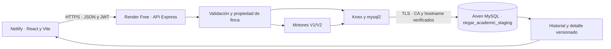
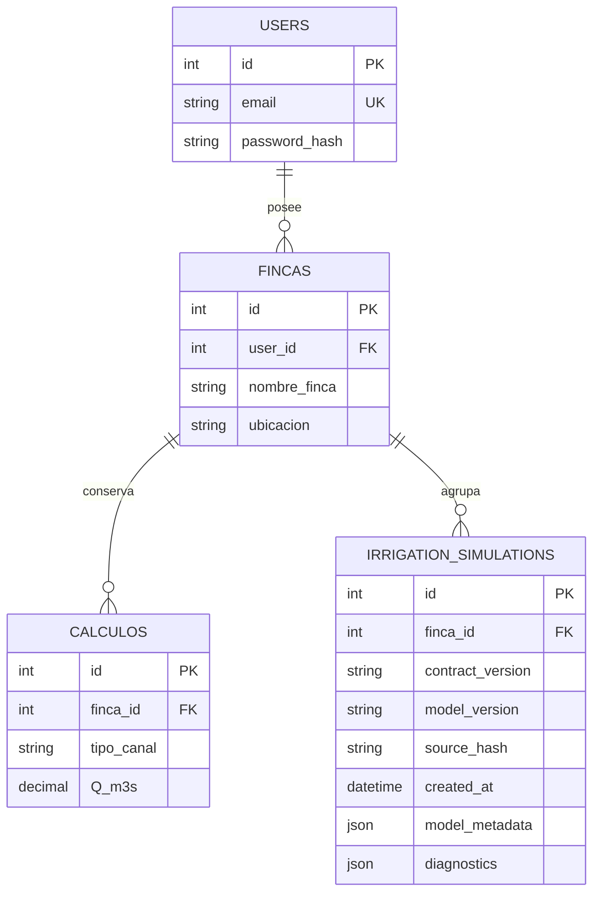

# RiegAR · Guía académica

## Objetivo y alcance

El riego por surcos distribuye agua a lo largo de canales en el suelo. El productor o estudiante necesita relacionar la demanda del cultivo, la reserva de agua, la geometría y los tiempos de aplicación. RiegAR permite organizar escenarios por finca, estimar magnitudes con un modelo derivado de una planilla y conservar resultados versionados para su consulta.

La publicación académica está disponible en https://riegar-academico.netlify.app y usa https://riegar-api-demo.onrender.com. Las pantallas públicas y Manning se verificaron contra esas URLs. Registro, login, alta y lectura de finca e historial vacío se verificaron con datos sintéticos autorizados. La lectura de snapshots históricos poblados permanece pendiente. El asistente V2 completo pertenece al entorno local con API simulada. La build pública conserva la creación V2 deshabilitada.

## Arquitectura y datos



- **Frontend.** React 18, Vite, React Router y SCSS Modules. Gestiona navegación, captura de entradas, validación de interfaz, sesión, consultas y presentación de resultados. El cliente HTTP es compartido.
- **Backend.** Node.js, Express, bcrypt, JWT, Knex y mysql2. Valida el payload y la sesión, verifica propiedad de la finca, selecciona el descriptor activo para altas y el contrato persistido para lecturas.
- **Persistencia.** MySQL almacena `users`, `fincas`, `calculos` (Manning), `irrigation_simulations` y las dos tablas de seguimiento de Knex. Un usuario posee fincas. Cada finca agrupa cálculos Manning y simulaciones. El snapshot contiene entradas, resultados, fecha, versión, hash de procedencia, metadata y diagnósticos. El índice de historial ordena por finca, fecha e ID. La FK de simulaciones restringe el borrado de la finca y la API devuelve 409 si conserva simulaciones.
- **Sesión y seguridad.** El backend compara hashes bcrypt y valida el JWT de cada acceso protegido. El frontend conserva el token en `localStorage`, comprueba vencimiento para la navegación y sincroniza el cierre de sesión. La autorización por finca se aplica en el servidor. CORS utiliza orígenes definidos y el despliegue requiere HTTPS, secretos fuera del repositorio y una cuenta MySQL de privilegios limitados. El almacenamiento del token hace importante controlar la inyección de scripts.



El diagrama muestra las entidades de negocio y campos representativos. Knex conserva por separado su registro de migrations y el lock.

## Modelo de riego por surcos

El servidor valida y normaliza los datos de cultivo, suelo, surcos y riego. La demanda acumulada simplificada se obtiene de ETo × Kc × días. La reserva útil se estima con la diferencia de humedad entre capacidad de campo y punto de marchitez, densidad y profundidad radicular. El área de referencia de cada surco combina espaciamiento y longitud. El volumen aplicado por surco resulta de caudal × duración en segundos. La infiltración en tres puntos se estima mediante el coeficiente del modelo y la raíz del tiempo de oportunidad. V2 multiplica el volumen por la cantidad de surcos para obtener el total del escenario. Los diagnósticos P01–P05 son comparaciones del modelo y tienen alcance estimativo.

| Modelo | Alcance |
|---|---|
| V1 | Ancho de surco y 14 magnitudes. El descriptor de escritura original es V1. |
| V2 | Espaciamiento, cantidad de surcos, consumo diario, plazos teóricos y totales del escenario. El lector interpreta 19 magnitudes. |
| Manning | Área y perímetro mojado, radio hidráulico y caudal en canales según geometría, rugosidad y pendiente. Se almacena en `calculos` y conserva sus rutas históricas. |

### Las 19 magnitudes V2

| Magnitud | Unidad | Interpretación |
|---|---|---|
| Lámina objetivo | mm | Demanda acumulada simplificada. |
| Consumo diario del cultivo | mm/día | ETo × Kc. |
| Agua útil disponible | mm | Reserva teórica entre capacidad de campo y punto de marchitez. |
| Capacidad disponible por surco | L | Agua útil expresada como volumen sobre el área de referencia. |
| Lámina máxima según umbral | mm | Fracción de la reserva útil según el umbral ingresado. |
| Volumen máximo según umbral por surco | L | Lámina del umbral aplicada al área de referencia. |
| Duración teórica de la reserva útil | días | Reserva útil dividida por consumo diario, desde capacidad de campo. |
| Plazo teórico hasta el umbral | días | Lámina del umbral dividida por consumo diario, desde capacidad de campo. |
| Volumen aplicado por surco | L | Caudal multiplicado por el tiempo de riego. |
| Infiltración estimada al inicio | mm | Lámina al inicio con el tiempo de oportunidad del modelo. |
| Infiltración estimada en la mitad | mm | Lámina en el punto medio. |
| Infiltración estimada al final | mm | Lámina al final, descontando el tiempo de avance. |
| Volumen útil estimado por surco | L | Estimación a partir de la infiltración en el punto medio. |
| Pérdidas estimadas por surco | L | Diferencia entre el volumen aplicado y el volumen útil estimado. |
| Volumen total aplicado | L | Volumen por surco multiplicado por cantidad de surcos. |
| Volumen total aplicado | m³ | Conversión del total de litros a metros cúbicos. |
| Eficiencia estimada de aplicación | % | Proporción del volumen aplicado que el modelo estima útil. |
| Relación de avance | % | Tiempo de avance respecto de la duración del riego. |
| Caudal máximo no erosivo estimado | L/s | Umbral calculado con la pendiente y los parámetros de la planilla. |

Con consumo diario cero, los dos plazos son `null`. La cifra de pérdidas representa un residuo del modelo. La interfaz puede abreviar valores con indicación de aproximación y consultar la precisión del snapshot. El modelo requiere contrastación de campo para usos agronómicos fuera del alcance académico.

## Instalación, configuración publicada y uso


Para la presentación se usa la publicación existente. Las ramas de despliegue se llaman demo-academica. El dominio público es riegar-academico.netlify.app, sin acento. Verificar el destino del enlace cuando el navegador traduce los nombres de proyecto.

Para reproducir el frontend localmente, instalá Node 24 y ejecutá npm ci y npm test. En PowerShell, prepará la build equivalente a Netlify:

```powershell
$env:VITE_API_URL='https://riegar-api-demo.onrender.com'
$env:VITE_RIEGAR_V2_MOCK='false'
npm run build -- --mode staging
```

npm run preview permite revisar ese artefacto local. El CORS público acepta el origen Netlify. Para desarrollar con una API local se necesita su propio origen y configuración CORS correspondiente. La creación V2 también queda bloqueada en el preview de producción.

En el backend, npm ci y npm test reproducen las pruebas offline. El servicio Render existente usa Node 24.16.0, npm ci y el comando node src/staging-server.js. Ese entrypoint valida el entorno académico, el nombre de base y cuenta, TLS, JWT y CORS antes de abrir el puerto asignado por Render. La ruta /api/health verifica HTTP y /api/ready verifica además identidad SQL y cifrado. El script npm start corresponde al servidor general, que exige variables SMTP.

| Variable pública o condición | Configuración académica |
|---|---|
| RIEGAR_RUNTIME | academic-staging |
| RIEGAR_DEMO_ENABLE_V2 | false |
| DB_NAME / DB_USER | riegar_academic_staging / riegar_staging_runtime |
| DB_HOST / RIEGAR_STAGING_DB_HOST | Host Aiven aprobado, idéntico en ambas variables |
| DB_SSL / DB_SSL_VERIFY_IDENTITY | true / true |
| CORS_ORIGIN | https://riegar-academico.netlify.app |
| DB_SSL_CA_PEM | CA oficial completa con delimitadores BEGIN/END y saltos de línea reales |
| DB_PASSWORD / JWT_SECRET | Valores privados del servicio, fuera de Git |
| EMAIL_USER / EMAIL_PASS | Ausentes, contacto informa correo deshabilitado |
| PORT / RENDER | Inyectadas por Render |

La cuenta runtime posee permisos de negocio limitados y SELECT sobre simulaciones. La cuenta migradora está bloqueada. Las cinco migrations ya están aplicadas. La presentación utiliza el schema académico preparado. La recuperación de un destino nuevo requiere su autorización y verificación de identidad independientes.

DEMO-02 completó el recorrido autenticado con tres POST autorizados y respuestas 201, 200 y 201. La cuenta y finca sintéticas quedaron disponibles para la presentación. Mis fincas muestra solo los registros de esa cuenta. El historial real está vacío, la recarga conserva la finca y logout protege nuevamente las rutas. Las credenciales se conservan en un archivo privado fuera del repositorio.

Manning está en el pie de página. En /calculadora, ingresar geometría, rugosidad, pendiente y dimensiones actualiza el caudal local. La exportación CSV es local. El guardado histórico asociado a finca es una operación de escritura distinta y queda fuera del presupuesto mínimo.

En desarrollo, el asistente local puede mostrarse con datos de fixture y el aviso de API simulada. Si se usa como apoyo, anunciarlo antes de abrirlo. Ese recorrido no acredita creación ni persistencia V2 en la publicación pública.

## Guion de demostración para la facultad

| Tiempo | Acción y punto a explicar |
|---|---|

| 0:00–1:00 | Abrir Inicio y explicar la gestión por finca. Mostrar las URLs y comprobar que la API está despierta. |
| 1:00–3:00 | Mostrar registro y login. Usar la cuenta sintética ya creada para acceder a Mis fincas y abrir la finca de demostración. Las respuestas reales 201/200/201 constan en las evidencias DEMO-02. |
| 3:00–4:00 | Abrir la finca y su historial. Si está vacío, explicar el estado vacío y la arquitectura de snapshots V1/V2. |
| 4:00–5:00 | Explicar el asistente Cultivo → Suelo → Surcos → Riego → Revisión y el bloqueo de creación V2 pública. Una captura de fixture, si se utiliza, lleva la etiqueta de demostración local. |
| 5:00–6:30 | Abrir Manning desde el footer. Cambiar dimensiones y mostrar el caudal local y la validación de un valor negativo. |
| 6:30–8:00 | Mostrar arquitectura, relación usuario/finca/snapshot y lectura según versión almacenada. Explicar alcance estimativo y pendientes de integración autenticada e históricos poblados. |

### Checklist antes de entrar a clase

- Abrir Inicio y GET /api/ready entre cinco y diez minutos antes. Esperar HTTP 200.
- Cargar Inicio, login, registro, guía y calculadora en pestañas.
- Llevar las capturas reales de DEMO-02 y esta guía disponibles localmente.
- Verificar la conexión y mantener el equipo conectado a energía.
- Comprobar que las credenciales sintéticas están disponibles privadamente, si el ensayo ya fue autorizado y ejecutado.
- Confirmar que la demo local, si se usa como apoyo, tiene su aviso visible y se anuncia como simulada.

### Contingencia para Render Free

Render puede dormir tras quince minutos de inactividad. Un GET puede necesitar cerca de un minuto para despertar el servicio. Antes del recorrido, abrir /api/ready y esperar; si el primer GET falla, comprobar una vez más tras la espera. Esta contingencia solo repite lecturas. [Límites de Render Free](https://render.com/docs/free)

Si no hay red o la API sigue indisponible, usar las capturas reales para explicar las pantallas. Manning puede calcular localmente una vez que la página está cargada. La web no está certificada como PWA offline y recargar sin red puede perderla. Para una demostración local preparada, usar el modo de desarrollo rotulado como API simulada. Ante un guardado incierto, conservar el mensaje y reconciliar por lectura antes de decidir otro envío.

Para repetir solo el recorrido académico en PowerShell, usá dos terminales en el frontend. Playwright debe estar disponible localmente y el argumento del script apunta a su `index.mjs`.

```powershell
$env:VITE_API_URL='https://riegar-v2.invalid'
$env:VITE_RIEGAR_V2_MOCK='true'
npm run dev -- --host 127.0.0.1 --port 4175 --strictPort
```

```powershell
$env:R5H_FILTER='MVP02'
$env:R5H_SCREENSHOTS='C:/ruta/evidencias-academicas'
node scripts/verify-r5-h-browser.mjs 'C:/ruta/playwright/index.mjs'
```

La suite usa Edge, intercepta la API y guarda seis capturas por resolución. El aviso **Demostración académica · datos de prueba** permanece visible en el recorrido. El POST de simulación, el 201, HISTORY y DETAIL provienen del mock en memoria.

## Pruebas, límites y evolución

Las pruebas públicas DEMO-02 recorren la versión HTTPS real a 1280, 390 y 320 px con respuestas reales. Se bloquearon los métodos de escritura como barrera de prueba y se registraron cero intentos. Las 27 comprobaciones autenticadas reales verificaron registro, login, finca, historial vacío, mensaje de detalle inexistente, recarga, logout y capacidad backend con creationEnabled=false. Los snapshots poblados V1/V2 permanecen pendientes. Los tests locales acreditan el contrato y el bloqueo V2 de la build de producción. La comprobación pública encontró una ruta desconocida sin contenido, enlaces sociales sin destino y avisos CSP en consola. Los correctivos fueron aprobados y publicados en demo-academica. Los avisos CSP se conservan como pendiente y no se relajó esa política. [Plan de staging](MVP-ACADEMICO-STAGING.md)
